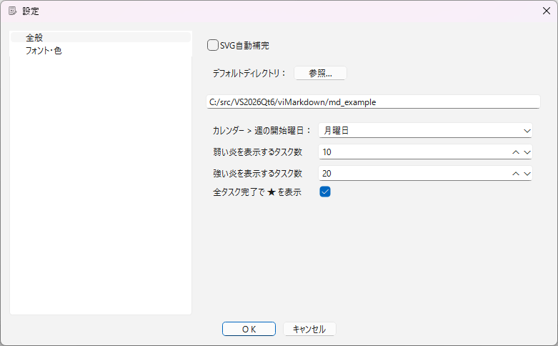
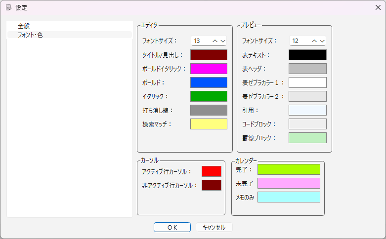
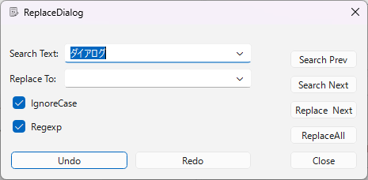
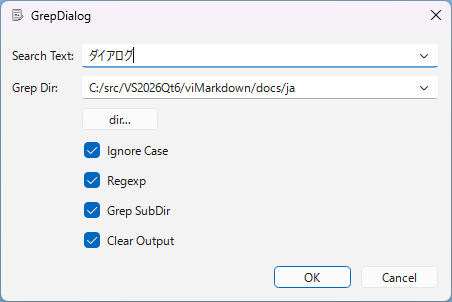
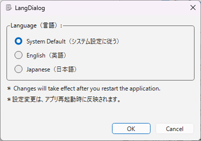

# Dialogs List

[README](../../README.md) > Dialogs List

## Settings Dialog

A dialog for configuring the editor and preview fonts, colors, and more.

Opened via Other > Settings... (F8). Use the tree on the left to switch between the two pages: General and Font/Color.
Other > Color Settings... (Shift+F8) opens the same dialog on the Font/Color page.

Changes take effect immediately. Pressing OK saves the settings; cancelling restores the state before the changes.

Note: calendar-related settings are split between the flame/★ settings (General page) and the colors (Font/Color page).

### General Page

|Item|Description|
|---|---|
|SVG auto-completion|Show completion candidates when editing an SVG block|
|Default directory|The default directory for operations such as opening files. Select it with the Dir... button|
|First day of week|The first day of the week in the Calendar Bar (default: Monday)|
|Flame display count (low)|If the total number of tasks for a day is at least this value, a low-intensity flame is shown on the calendar (default: 5)|
|Flame display count (high)|If the total number of tasks for a day is at least this value, a high-intensity flame is shown on the calendar (default: 10)|
|Show ★ when all tasks are completed|Show ★ on the calendar for days on which all tasks are completed (default: on)|

### Font/Color Page

#### Editor

|Item|Description|
|---|---|
|Font size|The editor font size|
|Title/Heading|Display color of title and heading text|
|Bold|Display color of bold text|
|Bold Italic|Display color of bold italic text|
|Italic|Display color of italic text|
|Strikethrough|Display color of strikethrough text|
|Search match|Display color of text matched by a search|

#### Preview

|Item|Description|
|---|---|
|Font size|The preview font size|
|Table header|Background color of table header rows|
|Table zebra color 1|Background color of odd rows (1st, 3rd, ...) of table bodies (zebra color)|
|Table zebra color 2|Background color of even rows (2nd, 4th, ...) of table bodies (zebra color)|
|Quote|Background color of quote blocks|
|Code block|Background color of code blocks|
|Keisen block|Background color of keisen (ruled-line) blocks|
|Table text|Text color in tables|

#### Cursor

|Item|Description|
|---|---|
|Active line cursor|Color of the line cursor on the side that has focus|
|Inactive line cursor|Color of the line cursor on the side that does not have focus|

#### Calendar

|Item|Description|
|---|---|
|Completed|Display color of the completed state in the Calendar Bar|
|Pending|Display color of the pending state in the Calendar Bar|
|NotesOnly|Display color of the notes-only state in the Calendar Bar|

## Replace Dialog

A dialog for searching and replacing text.
Opened via Search > Replace... (F4).

|Item|Description|
|---|---|
|Search text|Enter the text to search for, or select it from the history|
|Replace to|Enter the replacement text, or select it from the history|
|Ignore case|Treat upper and lower case as the same when searching|
|Regular expression|Treat the search text as a regular expression (QRegularExpression)|
|Search Prev|Search toward the beginning of the document from the cursor position|
|Search Next|Search toward the end of the document from the cursor position|
|Replace & Next|Replace the current match and search for the next one|
|Replace All|Replace all matching text|
|Undo|Undo an edit (replace operations are also covered)|
|Redo|Redo an edit (replace operations are also covered)|
|Close|Close the dialog|

## Grep (Find in Files) Dialog

A dialog for searching for text in the Markdown files (`*.md`) in a specified directory.
Opened via Search > Grep... (Shift+F4). Matching lines are shown in the Output Bar; double-clicking a line jumps to that line in the file.

|Item|Description|
|---|---|
|Search text|Enter the text to search for, or select it from the history|
|Search directory|Enter the directory to search in, or select it with the dir... button|
|Ignore case|Treat upper and lower case as the same when searching|
|Regular expression|Treat the search text as a regular expression (QRegularExpression)|
|Clear output|Clear the Output Bar before running the search|
|Search subdirectories|Also search in subdirectories|

## Language Settings Dialog

A dialog for setting the UI display language.
Opened via Other > Language... (Alt+F8). Changes take effect when the application is restarted.

|Item|Description|
|---|---|
|Follow system settings|Display according to the OS language settings|
|English|Display the UI in English|
|Japanese|Display the UI in Japanese|
