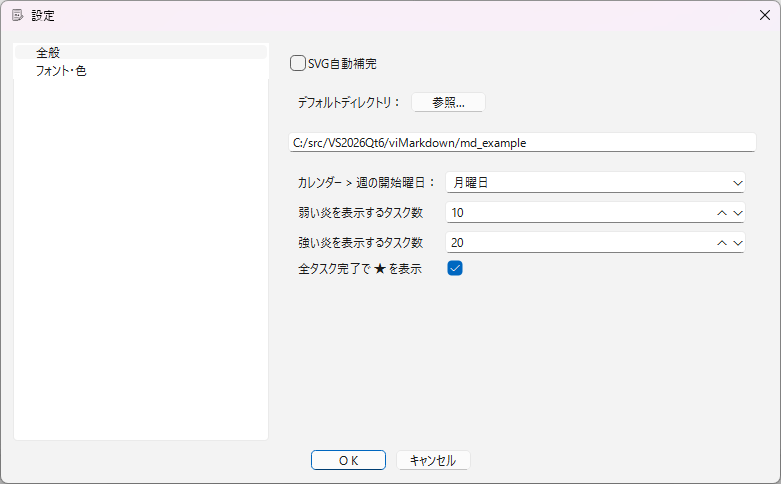
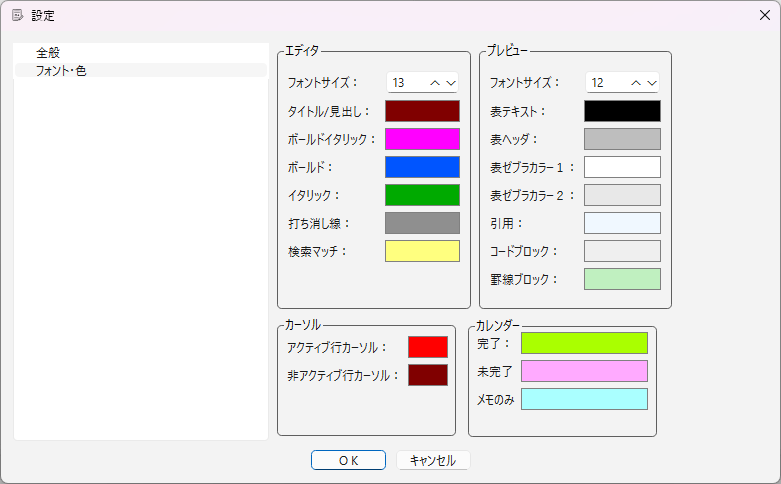
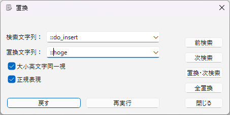
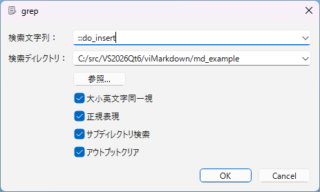
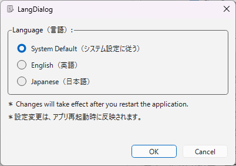

# ダイアログ一覧

[README_ja](../../README_ja.md) > ダイアログ一覧

## 設定ダイアログ

エディタやプレビューのフォント・色などを設定するダイアログです。
その他 > 設定... (F8) で表示されます。左側のツリーで General（全般）と Font/Color（フォント・色）の2ページを切り替えます。
その他 > 色設定... (Shift+F8) は、同じダイアログを Font/Color ページで開きます。




### General（全般）ページ

```CSV
" 項目 ", " 説明 "
"SVG自動補完", "SVGブロック編集時に補完候補を表示する"
"デフォルトディレクトリ", "ファイルを開くときなどの既定のディレクトリ。Dir... ボタンで選択する"
"週の開始曜日", "カレンダーバーの週の開始曜日"
"炎表示数（弱）", "その日のタスク総数がこの値以上で、カレンダーに弱い炎を表示する"
"炎表示数（強）", "その日のタスク総数がこの値以上で、カレンダーに強い炎を表示する"
"全タスク完了で ★ を表示", "その日のタスクがすべて完了した日に、カレンダーへ ★ を表示する"
```

### Font/Color（フォント・色）ページ

エディタ：

|項目|説明|
|---|---|
|フォントサイズ|エディタのフォントサイズ|
|タイトル/見出し|タイトル・見出しテキストの表示色|
|ボールド|ボールドテキストの表示色|
|ボールドイタリック|ボールドイタリックテキストの表示色|
|イタリック|イタリックテキストの表示色|
|打ち消し線|打ち消し線テキストの表示色|
|検索マッチ|検索にマッチしたテキストの表示色|

プレビュー：

|項目|説明|
|---|---|
|フォントサイズ|プレビューのフォントサイズ|
|表ヘッダ|表のヘッダ行の背景色|
|表ゼブラカラー１|表の偶数行の背景色（ゼブラカラー）|
|表ゼブラカラー２|表の奇数行の背景色（ゼブラカラー）|
|引用|引用ブロックの背景色|
|コードブロック|コードブロックの背景色|
|罫線ブロック|罫線ブロックの背景色|
|表テキスト|表のテキスト色|

カーソル：

|項目|説明|
|---|---|
|アクティブ行カーソル|フォーカスを持つ側の行カーソルの色|
|非アクティブ行カーソル|フォーカスを持たない側の行カーソルの色|

カレンダー：

|項目|説明|
|---|---|
|Completed|カレンダーバーの完了状態の表示色|
|Pending|カレンダーバーの未完了状態の表示色|
|NotesOnly|カレンダーバーのメモのみ状態の表示色|

## 置換ダイアログ

テキストの検索・置換を行うダイアログです。
検索 > 置換... (F4) で表示されます。



|項目|説明|
|---|---|
|検索文字列|検索する文字列を入力、または履歴から選択|
|置換文字列|置き換える文字列を入力、または履歴から選択|
|大小英文字同一視|検索時に大文字・小文字を同一視する|
|正規表現|検索文字列を正規表現として扱う|
|前検索|文書先頭方向に向かって検索|
|次検索|文書末尾方向に向かって検索|
|置換・次検索|現在のマッチを置換し、次を検索|
|全置換|マッチする文字列をすべて置換|
|戻す|編集を元に戻す（置換操作も対象）|
|再実行|編集をやり直す（置換操作も対象）|
|閉じる|ダイアログを閉じる|

## グレップ（ファイルから検索）ダイアログ

指定したディレクトリ内の Markdown ファイル（*.md）から、文字列を検索するダイアログです。
検索 > grep... (Shift+F4) で表示されます。マッチした行はアウトプットバーに表示されます。



|項目|説明|
|---|---|
|検索文字列|検索する文字列を入力、または履歴から選択|
|検索ディレクトリ|検索対象のディレクトリを入力、または dir... ボタンで選択|
|大小英文字同一視|検索時に大文字・小文字を同一視する|
|正規表現|検索文字列を正規表現として扱う|
|アウトプットクリア|検索実行前にアウトプットバーを消去する|
|サブディレクトリ検索|サブディレクトリ内も検索対象にする|

## 言語設定ダイアログ

UI の表示言語を設定するダイアログです。
その他 > 言語設定 (Alt+F8) で表示されます。設定変更は、アプリ再起動時に反映されます。



|項目|説明|
|---|---|
|システム設定に従う|OS の言語設定に従って表示する|
|English（英語）|UI を英語で表示する|
|Japanese（日本語）|UI を日本語で表示する|
