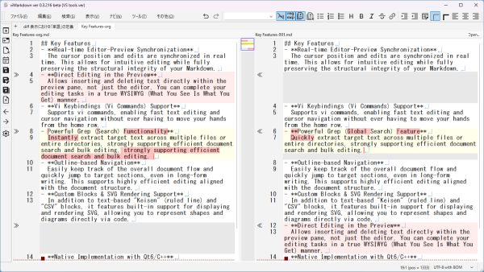

# diff 表示における「単語」の定義

## 背景
- viMarkdown：２つの文書を比較（diff）し、結果をわかりやすく可視化可能
- 
- 最初に、ブロック単位で比較し、挿入・削除・変更行の背景を明るいピンク、グレイ、ライトイエローで強調する
- 変更行では、単語単位で比較し、不一致単語を濃いピンクで強調する（画像参照）
  - 単語の定義は次節以降を参照
  - 「abc XYZ def」と「abc AY7 def」を比較した場合、「XYZ」「AY7」をひとつのまとまりにした方がわかりやすいため
- 比較結果のわかりやすい可視化に加え、ブロック単位・単語単位で差分を比較相手文書に反映可能
- 行番号エリアの ≫ ≪ を押下すると、ブロック単位で、文章を相手文書に反映させることが可能
- 変更行の単語強調された部分を右ボタンクリックし、「相手文書に反映」を実行すると、その単語を相手文書に反映させる
## 元々の「単語」の定義
- 元々は同種別の文字の並びをひとつの単語と定義していた
- 種別：半角英数字、半角記号、空白類、全角漢字、全角ひらがな、全角カタカナ、全角記号、全角英数字、・・・
## 問題の経緯
- 「abc XYZ def」と「abc AY7 def」を比較した場合、"XYZ" と "AY7" が変更行内で強調され、それぞれを相手文書に反映させることができる。
- 「abc XYZ def」と「abc def」を比較した場合、"XYZ" のみが強調され、相手文章に反映させると、「abc XYZdef」となり、"XYZ def" と "XYZdef" が不一致だと強調されてしまう（単語単位比較のため）
- そこで、v0.3.216 で 単語の定義を「同種別文字列＋半角空白列」に変更した
- 先の例であれば "XYZ " がひとつの単語となり、相手に反映させると「abc XYZ def」と綺麗に収まった。
- が、「abc」と「abc def」を比較した場合は、"abc" と "abc " が不一致で、全てが変更箇所と認識され好ましくない
