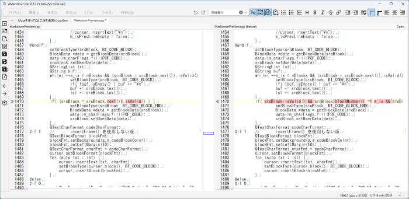
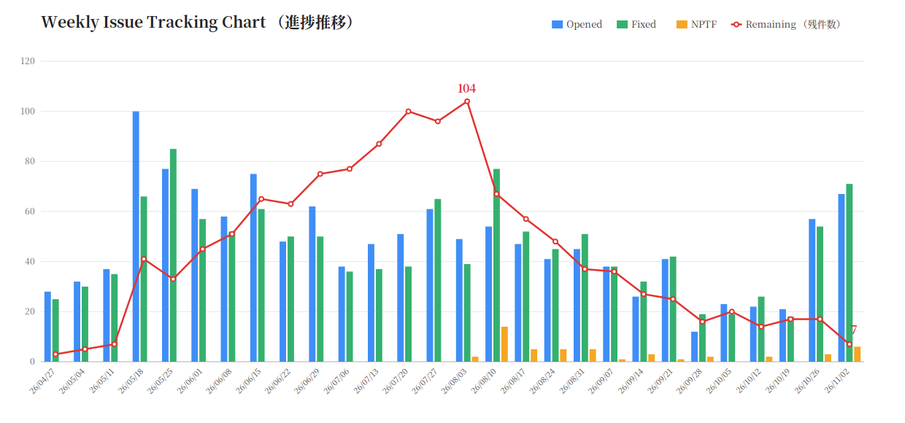

# Museを使ってQA工程を「全身を赤く塗ってもいいほど」爆速化（当社比）した話

## 目次

- 概要
- 背景：個人開発とQAの壁
- Muse の導入と役割分担
- QAワークフローの実際
- 成果（数字）
- 疲労が律速だった
- うまくいかなかったこと・教訓
- まとめ

## 概要

- これまでは生成AIチャットのみを使用して、viMarkdown 開発を行っていた
  - viMarkdown は vi コマンド・プレビュー内編集機能等を持つマークダウンエディタ
- 2026年9月に日本でリリースされた AI エージェント「Muse」を開発アシスタントとして試しに導入してみた
  - Muse とは：専用のVM（仮想環境）を持ち、VM内でリポジトリをクローンして調査・検証・下書きを自律的に行える AI エージェント
  - チャットAIと違い、Muse 側の VM 内で実際にプログラムを実行しながら、調査・検証・パッチ作成まで行える
  - 例：寝ている間に日次テストを回して、起きたら結果を報告してくれる。PCはシャットダウンしてもOK
- 結果：QA工程が爆速化（当社比）された
  - ※QA とは quality assurance の略で、品質保証のこと、要するにテスト＆デバッグ
  - MuseをQAに使用することで、問題発見件数・対処件数が約2.5倍になった
  - 爆速化の正体は「AIが速く書く」ことではなく、「再現→切り分け→修正→検証」の往復が速くなったこと
  - 具体的に任せた作業
    - 原因追究
    - 修正パッチ（差分）の生成
    - 回帰テスト
    - ランダムテスト

## 背景：個人開発とQAの壁

- 開発中のプロダクト：Qt6/C++ 製 Markdown エディタ「viMarkdown」（個人開発、11月上旬現在ベータ版）
- プレビュー内編集・diff のような相互作用系の機能は、エッジケースが多く、不具合が残りやすく、回帰も起きやすい
- チャットAIとの開発の限界
  - コードの受け渡しが手作業で、文脈（前提・仕様・過去の判断）が毎回リセットされる
    - 大量のソースコードをチャットAIに渡すのは限界がある
  - 再現・切り分け・検証は結局すべて自分がやることになり、QA が律速（ボトルネック）になる
- 心理的な壁もある
  - 他人の間違いを探してグリグリするのは楽しい（やる気が出る）
  - 自分で書いたコードのテストは、自分の間違いを探すことになるので、いまいち気が進まない
  - 個人開発では書く人とテストする人が同一人物なので、この心理がモロに効く

## Muse の導入と役割分担

- Muse は自分の VM を持ち、リポジトリのクローン上で調査・検証・下書きができる
- 分業ルールを決めた
  - 自分の立場は「権限のあるQA」。ソースツリーの所有者は自分のままにする
    - Muse には調査・検証・修正案の作成を任せるが、正本のソースツリーへの変更権限と最終判断は自分が保持する

| 工程 | Muse（AIエージェント） | 自分（人間・オーナー） |
| --- | --- | --- |
| 問題の検知 | 日次ランダムテスト・自動テストの実行と報告 | 手動確認、実際に触って違和感を見つける |
| 切り分け・再現 | 再現手順の作成、原因の切り分け | 「仕様か不具合か」の判定 |
| 起票 | しない（候補の報告まで） | SPR の起票 |
| 修正 | パッチ・テストケースの起草 | レビュー、適用、ビルド、実行 |
| 判断・クローズ | 分析と推奨まで | 仕様判断、クローズ判断 |

  - ※SPR（Software Problem Report）：GitHub の Issue のような問題管理チケットのこと
  - 下記に 11/01 に起票したSPRを示す

> 1255 ◎ C 11/01 11/02 03209│問題│diff表示時：行挿入でダミー行が実テキストを取り込み、再diffでテキストが消失する（Muse）
> 1256 ● D 11/01          │問題│ウィンドウリサイズ時に、diff再計算が行われていないため、ダミー行が挿入・削除されず、左右行が揃わなくなることがある
> 1257 ◎ C 11/01 11/01 03209│問題│プレビュー内編集：太字内の選択置換で閉じ ** が消えることがある（Muse）
> 1258 ◎ B 11/01 11/01 03209│問題│プレビュー内編集：（通常テキストの）ボールド強調された文字列全体を選択した場合、エディタ側は末尾 ** を選択しない方がよい
> 1259 ◎ C 11/01 11/01 03209│問題│プレビュー内編集：リスト行内のボールド強調された文字列全体を選択した場合、エディタ側は末尾 ** を選択しない方がよい（Muse）

- AI にツリーを直接編集させない方式を選んだ理由
  - ソースコードを把握できなくなることへの忌避
  - AI が意図しない変更を混入させるリスクを抑えられる
  - 変更内容を差分（パッチ）としてレビューできる
    - undone
  - AI の作業結果を独立して検証できる

## QAワークフローの実際

- SPR（問題票）駆動
  - 状態記号（●オープン／◎修正してクローズ／◯直さずクローズ）で一覧管理
  - Muse が「失敗」と判定しても即起票はしない。自分が問題か仕様かを確認・切り分けてから起票する
- 自動テスト基盤の維持
  - vi/ex コマンド 655件（vi/ex の動作検証）、カーソル同期 285件（エディタ⇔プレビューのカーソル位置の対応）、diff 4件（diff 表示・編集の固定ケース）。種類が異なるため、合計件数は出さず内訳のみ示す
  - diff の固定ケースが少ないのは、期待値を書きにくい領域だから。固定ケースは最小限にし、日次ランダムテストで補っている
  - 期待値は本家 Vim 9.1 のヘッドレス実行で裏取りしてから書く
- 日次ランダムテスト
  - 毎日深夜（cron）に最新 push をビルドし、プレビュー内編集 20件＋diff 20件をランダム抽選（seed は実行日）して実行、結果を報告
  - 失敗の分類：「既知の系統」「期待値モデル側の誤り」「新規」。仕様と食い違う場合はアプリではなくモデル（期待値）を疑って直す
  - 実例：ある朝のランダムテストが「文書先頭で Ctrl+Backspace を押すと先頭文字が消える」問題を検出（未起票）。自分が確認し「通常の BackSpace でも再現する」と最簡の条件で起票（#1282）。パッチを受け取って適用し、同日クローズした
- パッチ受け渡しと :merge
  - 当初は、Muse が生成したパッチを自分が目で確認し、手動マージしていた。時間がかかるうえ、マージのミスもあった
  - パッチは unified diff・フルパス・正確な行番号で受け渡す、と形式を取り決めても、手作業の負担そのものは残った
  - そこで、ベータ期間の「新機能禁止」ルールをあえて破り、受け取ったパッチを適用して diff 表示する :merge をこっそり実装した（一般ユーザー向けではない、開発者専用の隠し ex コマンド、メニューに追加するとバレてしまうため）
  - 結果として、確認とマージが高速になり、マージのミスも無くなった

- ドキュメント整備も同じ流れで回る（メニュー一覧・ダイアログ一覧の棚卸し、翻訳漏れの洗い出し）

## 成果（数字）

- 週次統計で見る処理ペースの変化（2026/04/27〜11/02、28週分）
  - 週ごとの起票数・クローズ数・残件数を集計した
    
  - Muse との協業が本格化した直近2週（10/26週・11/02週）と、その直前4週（09/28〜10/19）の週平均を比べると
    - 起票：19.5件／週 → 58.5件／週（3.0倍）
    - クローズ：20.5件／週 → 60.0件／週（約2.9倍）
  - 起票が増えたのは、片手間だったテストを Muse が専任QAのように毎日・網羅的に回すようになり、問題の検出力が上がったため。クローズの増加は、修正側の回転の速さを示す
  - 残件数は10月半ばの17件から、最新週（11/02週、途中経過）で5件まで減少した（内訳は優先度 C が2件、D が2件、E が1件）。起票が増えても積み上がっていないことが、ここからも分かる
  - 協業が本格化した後の2週間で、SPR の起票・クローズ件数は約3倍になっている
  - これは「全身を赤く塗ってもいいほど」の爆速化（当社比）だ。
- 数字の読み方（前提）
  - 自分の（実質）作業時間は大きく変えていない。増えたとすれば、エージェントの作業を待つ時間を含めた総稼働の方。作業時間を測ったわけではないので、「何倍効率化した」という言い方はしない。示すのは起票・クローズ・残件の客観的な件数だけ
  - 起票の増加には、質の違う要素が混ざっている
    - 日次ランダムテスト・いにしえSPRの回帰チェックで「今まで手が回らなくて見えていなかった範囲」を見えるようにした分
    - つまり発見範囲が広がって起票自体が増えたのであって、単に処理が速くなっただけではない
  - 増えた発見を滞留させずに捌き切って残件を減らせた、というのが「爆速化」の中身
- テストスイートは全緑（オールグリーン）を維持したまま、ランダムテストで新規問題を継続的に検出
- 補足：短期の集中成果
  - 2026/10/24〜11/05 の13日間で SPR クローズ 100件超
    - 内訳（◎修正してクローズ／◯直さずクローズ）と、同期間の起票数は、SPR ログから集計して記入する（未記入）
    - 件数だけでなく「起票から解決までの時間」も速度の指標になる
- 副産物：設定・grep・置換ダイアログの日本語化漏れ（obsolete / vanished 化した翻訳）の発見と修正、ドキュメントの GFM 化など
- スケジュールへの波及：ベータ期間の短縮
  - 残件数は 2026-08-03 週に 104 件でピークを打ち、以後は対処が発見を上回る週が続いている（現時点で 13 週）
  - かつて会社の先輩に「開発期間とテスト・問題対処期間は 1:1」と教わった
  - ピークまでの開発優位が 15 週だったので、対処優位も 15 週で揃えると、ベータは 2026-11-22 までで足りる計算になる
  - RC リリースを当初の 2026-12-14 から 2026-11-23 へ前倒しすることにした。ただし、問題が大量に見つかって残件が減りきらない場合は延期する
  - 品質を落とさずに（自動テストは全緑を維持し、ランダムテストで検査範囲はむしろ広げて）ベータ期間を短縮できた、というのが Muse 導入の成果のもう一つの形

## 疲労が律速だった

- 律速になっていたのは時計の時間ではなく疲労だった
- 再現手順の作成、原因の切り分け、テストの実行、パッチの起草といった「疲れるが判断のいらない作業」を Muse が担う
- 自分は判断と確認に集中でき、待ち時間は休憩になる
- 結果として、実質作業時間が同じでも総稼働を伸ばせた。処理量が増えた要因の一つはこれ
- 分業は心理面にも効いた：不具合の候補を挙げるのは Muse で、自分は吟味・判定する側に回る。「他人の間違い探し」の構図になるので、QA が苦行にならない
- 個人開発では QA 担当も自分自身なので、疲れてくると QA そのものが滞る。その意味でも効いた

## うまくいかなかったこと・教訓

- AI は間違える（実例1：翻訳状態の誤報）
  - Muse が翻訳エントリの状態を obsolete しか確認せず「正常」と報告した。実際は vanished という別の無効状態で、grep ダイアログは翻訳が効いていなかった
  - 発見したのは人間側。実際にダイアログを開いて英語表示に気づいた
  - その後のルール化：「.ts の監査では obsolete と vanished の両方を数える」を作業規則に明記した
- AI は間違える（実例2：予測外し）
  - 「この変更では直らないはず」という予測が外れ、対象 SPR が自然治癒でクローズした
- 対策は「鵜呑みにしない仕組み」
  - 「確定」と言う前に手元のデータに反証ケースが無いか当たる
  - 切り分けは、自分が問題を確認・認識してから開始する（AI の独断先行を禁止）
  - テストケースは検証開始前に提示し、検証するか自体も事前に確認する
  - 期待値モデルの誤りとアプリのバグを混同しない運用
- Muse の前提・制約：VM 環境は揮発性
  - VM上でビルドするには Qt6 が必要なので、要インストール（要20～40分）
  - なのだが、VM自体が頻繁（週数回）にアップデートされ、Qt6が消えてしまう
  - そのため、Qt6インストールが始まると数10分待たされてしまう
  - 待ち時間は別の作業や休憩に充てていた。結果的に「強制的な休憩」として、疲労の蓄積を防いでいた面もある

## まとめ

- 爆速化の正体は、冒頭で述べた通り「再現→切り分け→修正→検証」の往復が速くなったこと
- 前提は分業とルール：AI は下書きと検証、人間は判断と所有
- ただし律速は消えたわけではなく、疲労から判断へ移動した。次の律速は人間側の確認・マージ・判断の作業だが、疲れる作業ではないので無理なく続けられる
- AIエージェントはQAエンジニアの代替ではない。人間の役割が「QA作業の担当者」から「QA工程の管理・監督者」へ再構成された、というのが実感
- 個人開発でも、AIエージェントを活用することでQA 工程はここまで回せる
