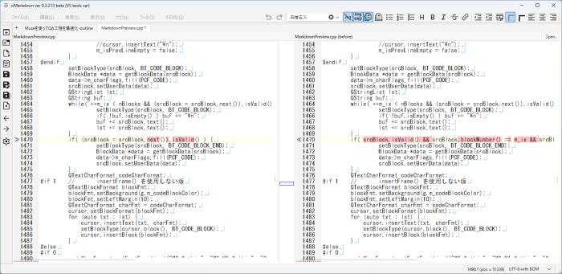
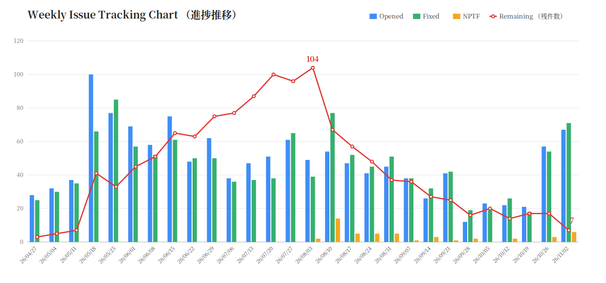

# Museを使ってQA工程を『全身を赤く塗ってもいいほど』爆速化（当社比）した話

## 概要

これまで、vi コマンドやプレビュー内編集機能を備えたマークダウンエディタ「viMarkdown」の開発には、チャット型の生成AIのみを使用してきた。

2026年10月22日に日本でリリースされた AIエージェント「Muse」を、開発アシスタントとして試しに導入してみた。Muse は専用の VM（仮想マシン）を持ち、その中でリポジトリをクローンし、プログラムを実際に実行しながら、調査・検証・パッチ作成を自律的に行う。ここがチャットAIとの大きな違いである。たとえば、寝ている間に日次テスト（自動テストやランダムテスト）を回し、起きたら結果を報告させる、といった使い方ができる。その間、PC はシャットダウンしていてもかまわない。

結果として、QA工程が爆速化（当社比）した。ここでいう QA（quality assurance、品質保証）は、テストとデバッグの工程を指す。Muse を QA工程に使ったところ、不具合の発見件数と修正件数は、週次平均でどちらも約3倍になった（直近2週間を、それ以前の4週間と比較した数値）。ただし、爆速化の正体は「AI が速くコードを書く」ことではない。「再現→切り分け→修正→検証」の往復が速くなったことにある。具体的に Muse に任せた作業は、原因究明、修正パッチ（差分）の生成、回帰テスト、ランダムテストである。なお、発見件数の増加は、Muse が探索的なテストで潜在的な不具合を掘り起こしているためで、修正件数の増加は、直す速さだけでなく、見つかる量にも引っ張られている。

## 背景：個人開発とQAの壁

viMarkdown は、Qt6/C++ 製の Markdown エディタである。個人開発で、2026年11月上旬時点ではベータ版の段階にある。

viMarkdown の特徴であるプレビュー内編集や diff のように、複数の要素が連動する機能は、エッジケースが多く、不具合が残りやすい。しかも、修正によって別の不具合が発生する、いわゆる回帰も起きやすい。こうした機能の品質を保つには、テストとデバッグ、すなわち QA に相応の手間がかかる。

チャットAIとの開発には限界があった。第一に、コードの受け渡しが手作業で、文脈が毎回リセットされる。前提・仕様・過去の判断を毎回説明し直す必要があり、大量のソースコードを一度に渡すことも難しい。第二に、チャットAIは修正案を提示できても、再現・切り分け・検証は結局すべて自分でやることになる。その結果、QA が開発全体のボトルネックになった。

心理的な壁もある。他人の間違いを探してグリグリするのは楽しいし、やる気も出る。ところが、自分で書いたコードのテストは、自分の間違いを探す作業になるので、いまいち気が進まない。個人開発では、書く人とテストする人が同一人物である。この心理がモロに効く。

## Muse の導入と役割分担

Muse は専用の VM を持ち、その中でリポジトリをクローンして、調査・検証・パッチ作成を行える。この能力をどう使うか、最初に分業のルールを決めた。

自分の立場は「権限のあるQA」とした。Muse には調査・検証・修正パッチの作成を任せるが、ソースツリーの変更権限と最終判断は自分が持つ。役割分担を工程ごとに整理すると、次のようになる。

| 工程 | Muse（AIエージェント） | 自分（人間・オーナー） |
| --- | --- | --- |
| 問題の検知 | 日次ランダムテスト・自動テストの実行と報告 | 手動確認（実際に触って違和感を見つける） |
| 再現・切り分け | 再現手順の作成、原因の切り分け | 「仕様か不具合か」の判定 |
| SPR のオープン | オープンはしない（候補の報告と概要文の起草まで） | 可否を判断してオープン |
| 修正・検証 | 修正パッチ・テストケースの起草 | レビュー、適用、ビルド、動作確認 |
| 判断・クローズ | 分析と推奨まで | 仕様判断、クローズ判断 |

※ SPR（Software Problem Report）：GitHub の Issue のような、問題管理チケットのこと。

参考として、11月1日にオープンした SPR を示す。末尾に（Muse）とあるものは、Muse が発見した問題である。その概要文は Muse が起草し、オープンするかどうかは自分が判断した。

```
1255 ◎ C 11/01 11/02 03209│問題│diff表示時：行挿入でダミー行が実テキストを取り込み、再diffでテキストが消失する（Muse）
1256 ● D 11/01          │問題│ウィンドウリサイズ時に、diff再計算が行われていないため、ダミー行が挿入・削除されず、左右行が揃わなくなることがある
1257 ◎ C 11/01 11/01 03209│問題│プレビュー内編集：太字内の選択置換で閉じ ** が消えることがある（Muse）
1258 ◎ B 11/01 11/01 03209│問題│プレビュー内編集：（通常テキストの）ボールド強調された文字列全体を選択した場合、エディタ側は末尾 ** を選択しない方がよい
1259 ◎ C 11/01 11/01 03209│問題│プレビュー内編集：リスト行内のボールド強調された文字列全体を選択した場合、エディタ側は末尾 ** を選択しない方がよい（Muse）
```

※ ◎ は修正してクローズ、● は未クローズ。英字は優先度、日付はオープン日とクローズ日、そのあとの5桁は修正したビルド番号を表す。

たとえば 1255 は、diff 表示中の行挿入と再diffという操作の組み合わせで、テキストが消失する（データ消失につながる）不具合である。

AI にツリーを直接編集させない方式を選んだ理由は、次のとおりである。第一に、自分がソースコードを把握できなくなる事態を避けられる。第二に、AI が意図しない変更を混入させるリスクを抑えられる。第三に、変更内容を差分（パッチ）としてレビューできる。第四に、AI の作業結果を、自分が独立して検証できる。

## QAワークフローの実践

開発は SPR 駆動で進めている。問題はすべて SPR として一覧化し、状態記号（● はオープン、◎ は修正してクローズ、◯ は直さずクローズ）で管理する。Muse がテストで「失敗」と判定しても、それだけでは SPR はオープンしない。報告を受けた自分が、仕様か問題かを切り分けてからオープンする。

この運用を支えるのが自動テスト基盤である。常時維持している固定ケースは、2026年11月上旬の時点で、vi/ex コマンドの動作検証が655件、エディタとプレビューのカーソル同期が285件、diff の表示・編集が4件である。ケースの種類が異なるため、合計件数は出さず、内訳のみを示す。なお、vi/ex の期待値は勘で書かず、本家 Vim 9.1 をヘッドレス実行して、実際の動作を裏取りしてから書く。一方、diff は期待値を書きにくい領域なので、固定ケースは最小限にとどめ、不足分は後述の日次ランダムテストで補っている。

Muse の VM では、毎晩深夜に cron が最新の push をビルドし、ランダムテストを実行して、結果を報告してくれる。対象はプレビュー内編集と diff で、それぞれ20ケースである。乱数の seed は実行日にしているので、失敗はその日付で再現できる。失敗は「既知の系統」「期待値モデル側の誤り」「新規」に分類して報告される。期待値が仕様と食い違っている場合は、アプリではなく期待値モデル側を直すのが原則である。

実例を示す。ある朝、前夜のランダムテストが、「文書先頭で Ctrl+Backspace を押すと先頭文字が消える」という問題を検出していた（この時点では SPR は未オープン）。自分が確認すると、通常の Backspace でも再現したため、最小の再現条件で SPR をオープンした（#1282）。Muse からパッチを受け取って適用し、その日のうちにクローズした。

修正パッチの受け渡しにも工夫が要った。当初は、Muse が生成したパッチを自分が目視で確認し、手動でマージしていた。時間がかかるうえ、マージのミスもあった。パッチは unified diff 形式とし、フルパスのファイル名と正確な行番号を付ける、と形式を取り決めたものの、手作業の負担そのものは残った。

そこで、ベータ期間の「新機能は実装しない」というルールをあえて破り、受け取ったパッチを適用して diff 表示する ex コマンド `:merge` を、こっそり実装した。一般ユーザー向けではない開発者専用の隠しコマンドであり、メニューに追加するとバレてしまうため、コマンド入力でのみ使えるようにしている。結果として、パッチの確認とマージが速くなり、マージのミスもなくなった。



ドキュメント整備も、同じ流れで進めている。メニュー一覧やダイアログ一覧の棚卸し、翻訳漏れの洗い出しといった作業も、Muse に調査と起草を任せ、自分が確認して取り込む形である。

## 成果（数字）

まず、週次統計で処理ペースの変化を見る。2026年4月27日から11月2日までの28週分について、週ごとの起票数・クローズ数・残件数を集計した。



Muse との協業が本格化した直近2週（10月26日週と11月2日週）と、その直前4週（9月28日週から10月19日週）の週平均は、次のとおりである。

- 起票数：19.5件／週 → 62.0件／週（約3.2倍）
- 修正クローズ数（◎）：20.5件／週 → 62.5件／週（約3.0倍）
- 残件数：17件（10月半ば）→ 4件（2026年11月9日時点。優先度 C が1件、D が2件、E が1件）

起票が増えたのは、筆者が片手間に行っていたテストを Muse が専任の QA のように毎日・網羅的に回すようになったためである。修正クローズの増加は、修正側の回転の速さを示している。起票が増えても残件は積み上がらず、むしろ減っている。協業が本格化した後の2週間で、SPR の起票・クローズ件数は約3倍になっている。これは「全身を赤く塗ってもいいほど」の爆速化（当社比）だ。

ただし、数字の読み方には前提がある。自分の（実質）作業時間は大きく変えていない。増えたとすれば、エージェントの作業を待つ時間を含めた総稼働の方である。作業時間を測ったわけではないので、「何倍効率化した」という言い方はしない。示すのは起票・クローズ・残件の客観的な件数だけである。

また、起票の増加には質の違う要素が混ざっている。日次ランダムテストや古い SPR の回帰チェックによって、今まで手が回らなくて見えていなかった範囲を見えるようにした分が含まれている。つまり、発見範囲が広がって起票自体が増えたのであって、単に処理が速くなっただけではない。増えた発見を滞留させずに捌き切って残件を減らせた、というのが「爆速化」の中身である。

テストスイートの失敗は放置せず全緑（オールグリーン）まで潰し切り、そのうえでランダムテストでも新規問題を継続的に検出している。

補足として、短期の集中成果も挙げておく。期間は直近2週と重なるが、2026年10月26日から11月8日までの14日間で見ると、起票124件に対し、クローズは◎修正してクローズ125件と◯直さずクローズ9件の計134件に上った。クローズが起票を10件上回っており、この期間にも残件は減っている。

副産物もある。設定・grep・置換ダイアログの日本語化漏れ（obsolete／vanished 化した翻訳）の発見と修正、ドキュメントの GFM 化などである。

成果はスケジュールにも波及した。残件数は2026年8月3日週に104件でピークを打ち、以後は減少傾向が続いている。かつて会社の先輩に「開発期間とテスト・問題対処期間は1:1」と教わった。ピークに達するまでの開発優位の期間が15週だったので、ピーク後の対処の期間も15週（11月16日週まで）とれば、ベータは2026年11月22日までで足りる計算になる。そこで、RC リリースを当初の2026年12月14日から11月23日へ前倒しすることにした。ただし、問題が大量に見つかって残件が減りきらない場合は延期する。品質を落とさずに（自動テストは全緑まで潰し切り、ランダムテストで検査範囲はむしろ広げて）ベータ期間を短縮できる見込みが立った、というのが Muse 導入の成果のもう一つの形である。

## 疲労が律速だった

律速になっていたのは、時計の時間ではなく疲労だった。再現手順の作成、原因の切り分け、テストの実行、パッチの起草といった「疲れるが判断のいらない作業」を Muse が担うことで、自分は判断と確認に集中できるようになった。Muse の作業を待つ時間は、そのまま休憩になる。結果として、実質作業時間が同じでも総稼働を伸ばすことができた。処理量が増えた要因の一つはこれである。

分業は心理面にも効いた。不具合の候補を挙げるのは Muse で、自分は吟味し、判定する側に回る。「他人の間違い探し」の構図になるので、QA が苦行にならない。個人開発では QA 担当も自分自身であり、疲れてくると QA そのものが滞る。その意味でも、この分業は効いた。

## うまくいかなかったこと・教訓

もちろん、AI は間違える。実例を2つ挙げる。

1つ目は、翻訳状態の誤報である。Muse が翻訳エントリの状態を obsolete しか確認せず、「正常」と報告した。実際には vanished という別の無効状態のエントリがあり、grep ダイアログでは翻訳が効いていなかった。発見したのは人間側で、実際にダイアログを開いて英語表示に気づいた。教訓は作業規則に明記した。「.ts の監査では obsolete と vanished の両方を数える」。

2つ目は、予測外しである。「この変更では直らないはず」という予測が外れ、対象の SPR は自然治癒でクローズした。

対策は、AI の言うことを鵜呑みにしない仕組みを作ることだった。「確定」と言う前に、手元のデータに反証ケースが無いか当たる。切り分けは、自分が問題を確認・認識してから開始する（AI の独断先行の禁止）。テストケースは検証を開始する前に提示し、検証を行うかどうか自体も事前に確認する。期待値モデルの誤りとアプリのバグを混同しない。これらはいずれも、実際に間違えられた経験から生まれた運用ルールである。

Muse 側の前提として、VM 環境の揮発性もある。Muse の VM でビルドするには Qt6 が必要で、インストールには20〜40分かかる。ところが VM 自体が頻繁（週に数回）にアップデートされ、そのたびに Qt6 が消えてしまう。このため、Qt6 のインストールが始まると数10分待たされることがある。待ち時間は別の作業や休憩に充てていた。結果的には「強制的な休憩」として、疲労の蓄積を防いでいた面もある。

## まとめ

爆速化の正体は、冒頭で述べた通り、「再現→切り分け→修正→検証」の往復が速くなったことである。その前提にあるのは分業とルールで、AI は下書きと検証を担い、人間は判断と所有を担う。

ただし、律速が消えたわけではない。律速は疲労から判断へ移動した。現在の律速は人間側の確認・マージ・判断の作業である。とはいえ、それは疲れる作業ではないので、無理なく続けられる。

AIエージェントは QA エンジニアの代替ではない。人間の役割が「QA 作業の担当者」から「QA 工程の管理・監督者」へ再構成された、というのが実感である。個人開発でも、AIエージェントを活用することで、QA 工程はここまで回せる。
