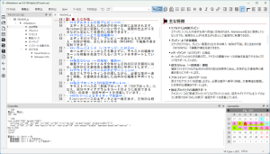
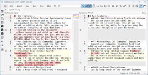
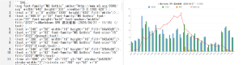

# viMarkdown
**viMarkdown** は、プレビューを見ながら編集可能な Markdown エディタです。Qt6 および C++ 採用により動作が軽くパフォーマンスに優れています。  
効率性を追求する 研究者・エンジニア・ライター・理系学生 に向けて設計・開発されています。
## ■ 主な特徴
```CSV
画面, 説明
, "・ **リアルタイム同期プレビュー**：エディタに入力した内容が右側へ即座に反映されます。
・ **プレビュー上編集**：プレビュー画面からも文字の挿入・削除が可能。WYSIWYGで編集作業を完結できます。
・ **アウトラインナビゲーション**：長文でもアウトラインを把握しながら、必要な箇所へ素早く移動。文書構造を意識した効率的な編集をサポートします。
・ **カレンダー連携・日記機能**：サイドバーのカレンダーからワンクリックで当日のノートを作成・オープン。テンプレートの自動展開や、ToDoタスクの達成度をカレンダー上で視覚的にトラッキングできます。"
, "・ **組み込みのDiff（文書比較）機能**
別ファイルや編集前後のテキストを2画面で行単位・単語単位比較し左右同期表示。ミニマップ表示や差分のワンクリック反映など、文書の推敲や版管理を支援します。"
, "・ **独自ブロックとSVG描画サポート**
「CSVブロック」やテキストベースの「罫線ブロック」に加え、図形やダイアグラムをコードのように表現できる「SVG」の表示・描画サポートを搭載しています。"
```

- **viキーバインド（viコマンド）に対応**：ホームポジションから手を離さずに、テキストの編集やカーソル移動を高速で行えるviコマンドをサポートしています。
- **Grep（一括検索）機能**：複数ファイルやフォルダ全体から目的の記述を瞬時に抽出。効率的な文書検索と編集をサポートします。
- **Qt6/C++によるネイティブ実装**：Electronベースのエディタとは一線を画す、圧倒的な軽さと高速な動作を実現しています。
